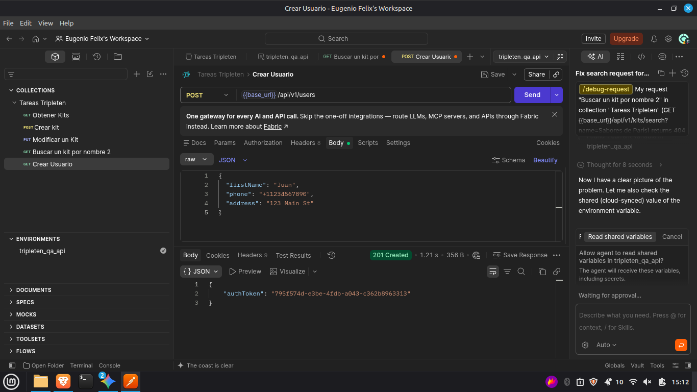
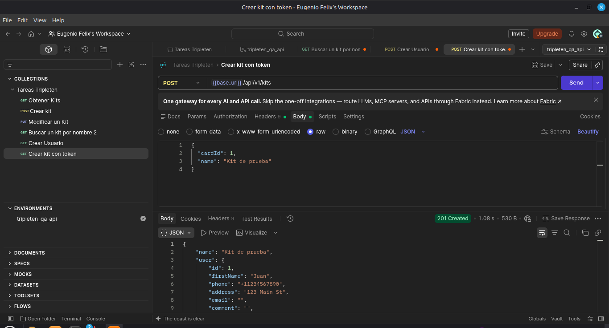
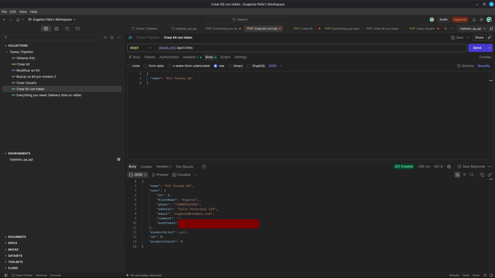
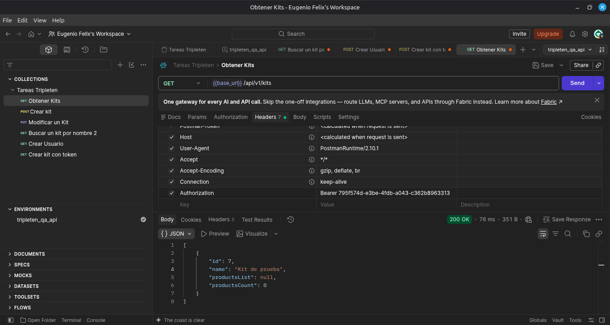

# QA Urban Routes Portfolio

QA automation and API testing portfolio built across four sprints: formal test design artifacts, manual API validation in Postman, and Python runners that execute API test suites, export CSV reports and generate a Jira-formatted bug report for every failed case.

---

## 🛠️ Tech Stack & Tools

- **Language:** Python
- **API test automation:** `requests` library with custom test runners (`src/engine/`)
- **Test design:** ISTQB techniques: Equivalence Partitioning (EP) and Boundary Value Analysis (BVA), plus negative and robustness cases
- **Test data:** JSON datasets (`src/data/`)
- **Manual API validation:** Postman (collection and environment variables)
- **Reporting:** CSV result files, execution summaries and Jira-formatted bug reports generated on failure
- **Environment:** Git, Linux Mint terminal

---

## 📂 Repository Structure

```text
qa-urban-routes-portfolio/
│
├── docs/        # Sprint test artifacts and deliverables (.xlsx)
├── reports/     # CSV test results and execution summaries
├── src/
│   ├── data/    # JSON datasets
│   └── engine/  # Python runners and data setup script
├── assets/      # Postman and terminal screenshots
├── LICENSE      # MIT License
└── README.md
```

---

## 🚀 Key Artifacts & Highlights

### 1. Test design artifacts (`docs/`)

| Sprint | Deliverable |
|---|---|
| 1 | Test artifacts |
| 2 | Equivalence test cases |
| 3 | Test artifacts |
| 4 | API test artifacts |

### 2. API test automation (`src/engine/`)

| Suite | Runner | Cases | How cases are defined |
|---|---|---|---|
| Delivery | `delivery_runner.py` | 29 | Loaded from `src/data/delivery_cases.json` (data-driven) |
| Kits | `kits_runner.py` | 23 | Defined in the runner (see [Roadmap](#-roadmap)) |

**Kits suite coverage:**

- Boundary Value Analysis on the 30-product limit (1, 29, 30 and 31 unique products) and on empty arrays
- Invalid quantities (0, negative, string) and invalid types in `id` fields
- Missing required properties, empty body and `productsList` that is not an array
- Non-existent kit and product IDs, repeated product IDs, wrong HTTP method
- Robustness checks: injection attempt in the kit ID path parameter and undocumented extra fields in the body

**Execution flow:** the kits runner creates a fresh user and auth token at the start of each run, executes every case, compares the actual HTTP status (and error message, where defined) against the expected result, and writes the results to CSV. Each failed case prints a ready-to-paste Jira bug report with title, steps to reproduce, payload, expected vs. actual result and response body.

**Execution reports (`reports/`):** CSV results and summary logs from the delivery and kits runs.

> **Note:** the runners target a temporary test container (`BASE_URL` in each runner). Update it to point to a live environment before re-running.

### 3. Postman API validation

Manual validation of endpoints, authorization flow and JSON responses, using a collection with an environment variable for the base URL.

| Create user: `POST /api/v1/users` returns `201` and an auth token | Create kit: `POST /api/v1/kits` returns `201` |
|---|---|
|  |  |

| Create kit with token: response includes the user object and `productsCount: 0` | Authorization: `GET /api/v1/kits` with a Bearer token returns `200` |
|---|---|
|  |  |

---

## 🧭 Roadmap

- Migrate the runners to **Pytest**: session-scoped fixtures for the base URL and auth token, and parametrized tests fed from the JSON datasets
- Move all kits cases into a valid JSON dataset, so both suites are fully data-driven
- Read the base URL from an environment variable instead of the source code

---

## 📄 License

This project is open-source and available under the MIT License.
